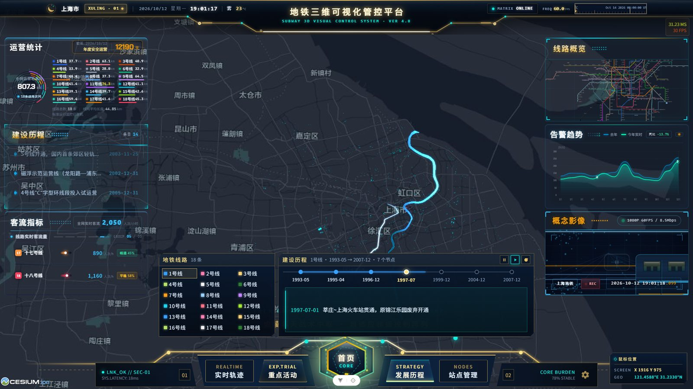
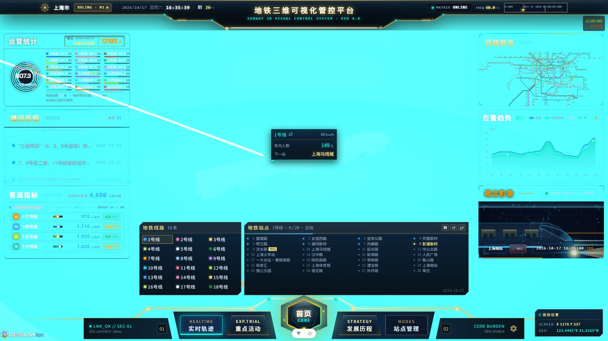
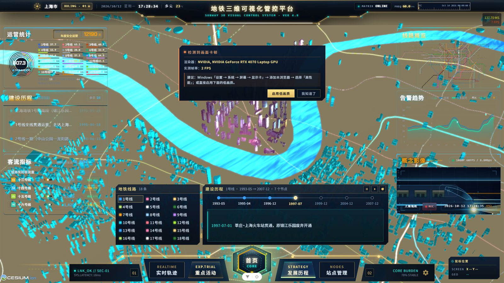

# 智慧地铁 · 上海地铁三维可视化平台（MetroProject）

基于 **Vue 3 + Cesium** 的上海地铁三维可视化系统。前端在 Cesium 数字地球上还原上海地铁全网线网，提供站点/线路管理、实时列车漫游、建设发展历程、重点活动保障、客流热力图、换乘路径规划与天气播报等模块；后端用 **Node.js + Express + PostgreSQL** 提供线网数据与高德开放平台代理。

> 仓库名：`MetroProject`。前端目录 `Translation/`、后端目录 `Translation_BE/` 沿用项目开发期的历史命名。

## 界面预览

| 线网总览（首页 CORE） | 实时列车轨迹 |
| --- | --- |
|  |  |

| 重点活动保障 | 建设发展历程 |
| --- | --- |
|  |  |

---

## 功能模块

| 模块 | 路由 | 说明 |
| --- | --- | --- |
| 线网总览 | `/` | 18 条线路、全网站点在三维地球上立体呈现；顶栏图层开关、全屏沉浸模式、性能守护 |
| 站点管理 | `/nodes` | 左侧线路列表 + 右侧站点控制栏；线路总闸与单站开关三级联动，站点照片弹窗、客流标签 |
| 线路轨迹 | `/realtime` | 列车沿线路折线漫游，位置由 Cesium 时钟唯一决定，支持进度拖拽、跟随视角、倍速 |
| 发展历程 | `/strategy` | 按年份回放上海地铁建设史：线路逐段生长动画 + 侧栏时间轴联动 |
| 重点活动 | `/experiment` | 保障活动对应线路光柱高亮，侧栏列出活动与保障站点 |
| 换乘路径规划 | `/nodes` → 查询 | 站到站公交/地铁联程方案，渲染分段折线与换乘节点、耗时费用卡片 |
| 客流热力图 | `/nodes` → 热力 | 站点客流密度热力图，锁定俯视视角并支持时间轴演变 |
| 天气 / 昼夜 | 顶栏 | 实时天气与四天预报；昼夜光照与水面、流动光效着色器联动 |

## 技术栈

**前端**：Vue 3（`<script setup>`）· Vite 8 · Vue Router 5 · Pinia · Cesium 1.97 · Turf · heatmap.js · video.js · axios
**后端**：Node.js · Express 5 · pg · PostgreSQL 14（表结构不变，人流量等字段由接口层模拟）
**地图服务**：高德开放平台 Web 服务 API（公交路径规划 v5、天气 v3）
**构建**：`vite-plugin-cesium` 拷贝 Cesium 静态资源；`vite.config.js` 自定义 `compressDist()` 为文本产物额外产出 `.gz` / `.br`

## 目录结构

```
MetroProject/
├── Translation/                   前端（Vue 3 + Vite + Cesium）
│   ├── src/
│   │   ├── api/                   后端接口封装（baseApi / request）
│   │   ├── assets/                站点照片、底图、列车 glb、线网 JSON
│   │   ├── cesiumTools/           三维能力：线路/站点/光锥/弹窗/列车/时间轴/昼夜
│   │   ├── components/            屏幕 HUD、底部面板、各功能面板
│   │   ├── config/                线路配色、发展历程、重点活动数据
│   │   ├── stores/                Pinia 状态（场景、站线、屏幕）
│   │   └── views/cesiumView.vue   Cesium Viewer 主视图（KeepAlive 常驻）
│   ├── .env.example               环境变量模板
│   └── vite.config.js
├── Translation_BE/                后端（Express + PostgreSQL）
│   ├── config.js                  统一配置，全部读环境变量
│   ├── index.js                   连接池 + 全部路由
│   ├── .env.example               环境变量模板
│   └── PROMPT.md                  接口契约与踩坑记录
├── Translaion.sql                 数据库结构与线网数据（开发期导出）
└── Translation2.sql               数据库结构（另一份导出）
```

## 快速开始

### 0. 环境要求

- **Node.js ≥ 22.18**（前端 `engines` 要求；后端用到内置 `fetch` 与 `process.loadEnvFile`）
- **PostgreSQL 14+**，库名 `Translation`
- 高德开放平台账号（申请**Web 服务**类型 Key，不是 JSAPI 类型）

### 1. 建库并导入数据

```powershell
# 建库
createdb -U postgres Translation

# 导入结构与数据（选一份即可）
psql -U postgres -d Translation -f Translation2.sql
```

### 2. 启动后端（端口 8092）

```powershell
cd Translation_BE
Copy-Item .env.example .env      # 然后填入 AMAP_KEY / PGPASSWORD
npm install
npm start                        # 或 node index.js
```

验证：<http://127.0.0.1:8092/getLine> 应返回 18 条线路。

> 端口被占用表现为「接口行为和代码不一致」（新增路由 404、改逻辑不生效），
> 多半是旧的 `node` 进程还占着 8092，排查步骤见 `Translation_BE/PROMPT.md`。

### 3. 启动前端（端口 5173）

```powershell
cd Translation
Copy-Item .env.example .env.local
pnpm install
pnpm dev
```

打开 <http://localhost:5173/>。生产构建 `pnpm build`，产物在 `Translation/dist/`。

> 若 `pnpm dev` 报 `ERR_PNPM_ABORTED_REMOVE_MODULES_DIR_NO_TTY`，是 pnpm 版本与本机
> store 格式不匹配触发了安装前校验；项目已在 `pnpm-workspace.yaml` 里关闭该校验
> （`verifyDepsBeforeRun: false`）。**不要**按提示设 `CI=true`。

## 环境变量

所有密钥只以环境变量形式注入，源码中无明文。两个 `.env.example` 是模板，真实文件已被 `.gitignore` 排除。

### 后端 `Translation_BE/.env`

| 变量 | 必填 | 说明 |
| --- | --- | --- |
| `PORT` | 否 | 服务端口，默认 `8092` |
| `AMAP_KEY` | **是** | 高德开放平台「Web 服务」类型 Key；缺失时路径规划/天气报 `INVALID_USER_KEY` |
| `AMAP_CITY` | 否 | citycode，默认 `021`（上海） |
| `AMAP_ADCODE` | 否 | adcode，默认 `310000`；天气接口只认 adcode |
| `PGUSER` / `PGPASSWORD` / `PGHOST` / `PGPORT` / `PGDATABASE` | 是 | PostgreSQL 连接信息 |

### 前端 `Translation/.env.local`

| 变量 | 必填 | 说明 |
| --- | --- | --- |
| `VITE_CESIUM_ION_TOKEN` | 否 | Cesium ion 令牌；本项目底图与地形都不走 ion，可留空 |

> ⚠️ **前端没有秘密**：以 `VITE_` 开头的变量会被 Vite 内联进 `dist` 的 js，浏览器里能直接读到。
> 需要真正保密的 Key（高德 Web 服务 Key、数据库密码）必须放在后端 `.env`。
> 部署时改用运行环境注入同名环境变量，`.env` 文件可以不存在。

## 后端接口

统一响应格式：`{ code, message, data }`（`200` 成功 / `400` 缺参 / `404` 无数据 / `500` 错误）

| 接口 | 说明 |
| --- | --- |
| `GET /getLine` | 线路 + 嵌套站点列表（含 `basicPrice`、`length`、`xs/ys` 折线坐标） |
| `GET /getStationInfo?name=` | 单站信息（所属线路、是否换乘、模拟客流） |
| `GET /getLinePlan?origin=lng,lat&destination=lng,lat` | 高德 v5 公交联程规划，拍平为 `cost/duration/distance/segments` |
| `GET /getWeather?extensions=base\|all&city=adcode` | 高德 v3 天气实况 / 四天预报 |

详细契约与踩坑记录见 [`Translation_BE/PROMPT.md`](Translation_BE/PROMPT.md)。

## 说明

- 线网数据为项目开发期整理，仅用于技术演示；运营信息（客流、到站时间、活动保障）均为接口层模拟。
- 站点实景照片来自公开网络，版权归原作者所有，仅作学习演示用途，见 `Translation/src/assets/stationImg/CREDITS.md`。
- 仓库不包含本地审图截图、第三方参考工程与课程资料，相关目录已在 `.gitignore` 中排除。
